# Activity 2 – Build Your Own Reusable Components

**Developer:** Elaine Mae M. Balbada  
**Course and Section:** ITE 18 – AIEM1  
**Framework:** Nuxt 4

---

## Project Overview

**SturRIA – Student Portfolio and Skills Showcase** is a student information website developed to demonstrate component-based development and component reusability using Vue and Nuxt.

The website provides a platform where students can introduce themselves and showcase their technical skills, personal interests, and individual strengths through organized student profiles.

Instead of repeatedly writing the same HTML structures, STURIA uses reusable Vue components to maintain consistency, simplify development, and make the website easier to manage.

## Technologies Used

- **Nuxt 4** – Application framework
- **Vue 3** – Component-based frontend development
- **TypeScript** – Programming language
- **Tailwind CSS v4** – Styling and responsive layouts
- **Nuxt Icon** – Icon integration
- **Lucide Icons** – Interface icons

## Website Features

- **Homepage** – Introduces STURIA and features selected student profiles.
- **Student Directory** – Displays student profiles in an organized layout.
- **Student Information Cards** – Showcases students' names, photos, courses, descriptions, skills, and social media links.
- **About Page** – Presents the purpose and objectives of the STURIA platform.
- **Reusable Components** – Uses shared Vue components across different pages.
- **Interactive Elements** – Includes hover effects, navigation interactions, and scroll-reveal animations.
- **Consistent Design** – Uses a clean green and ivory color palette throughout the website.

## Screenshots

### 1. Homepage

The homepage introduces the STURIA platform, features selected students, and presents the main highlights of the website.

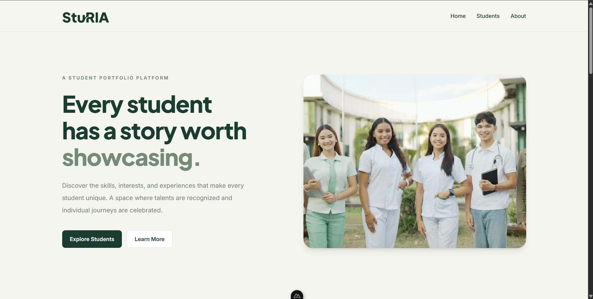

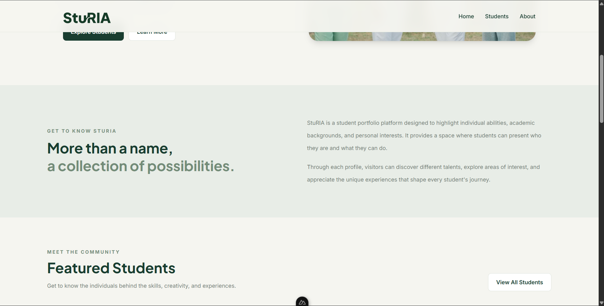

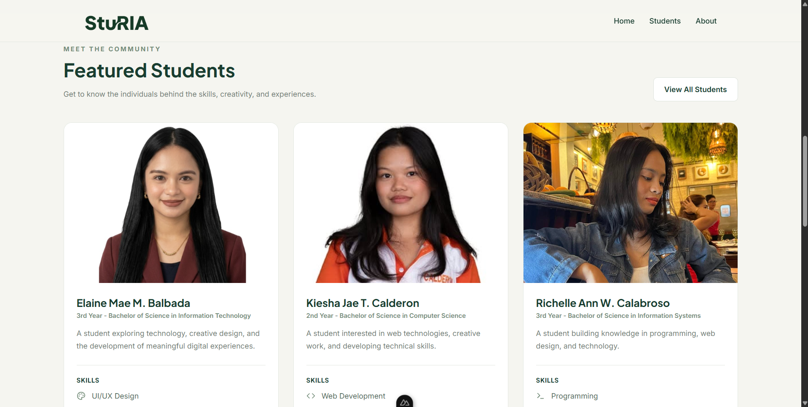

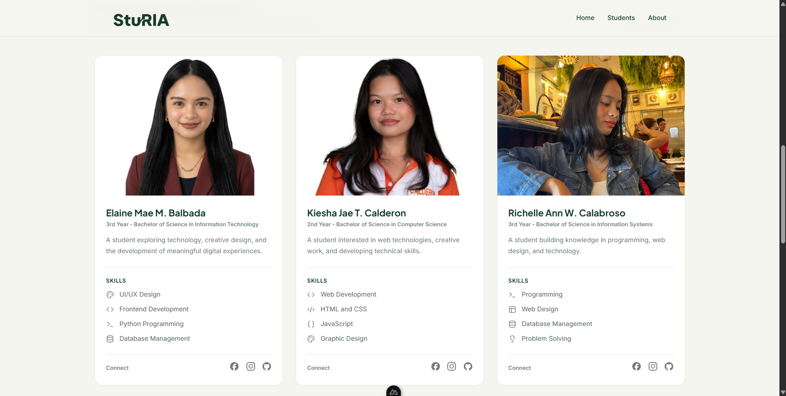

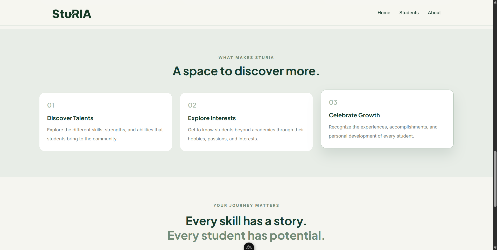

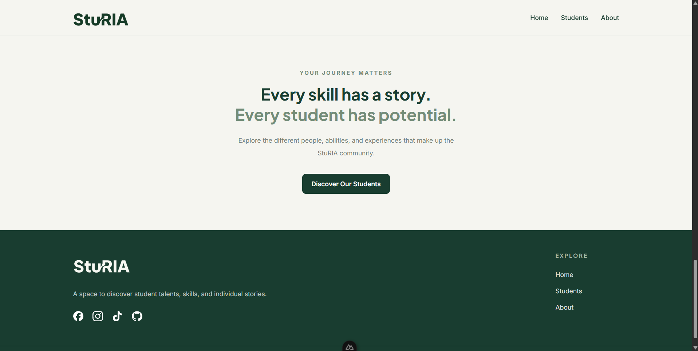

### 2. Student Directory

The Students page displays the student directory, allowing visitors to explore the profiles and information of all featured students.

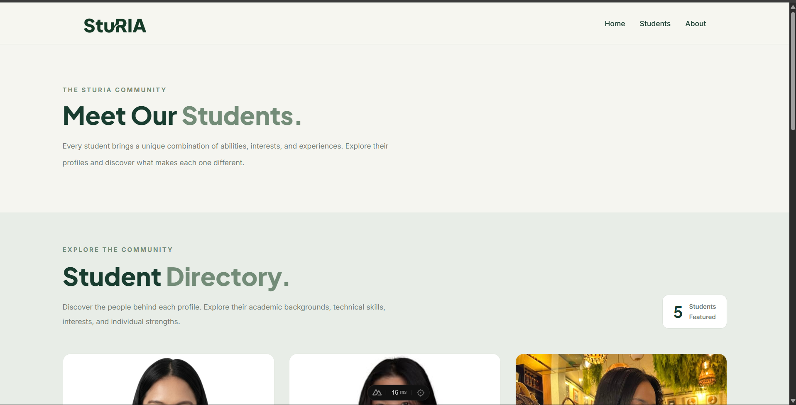

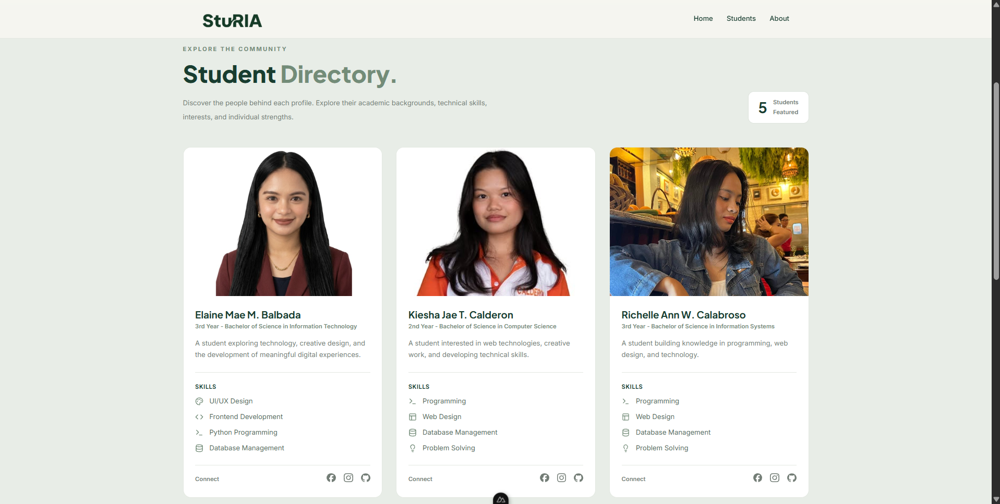

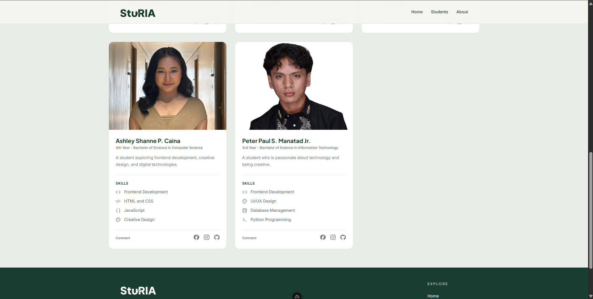

### 3. About Page

The About page explains the purpose of STURIA and its objectives in showcasing student talents, interests, and growth.

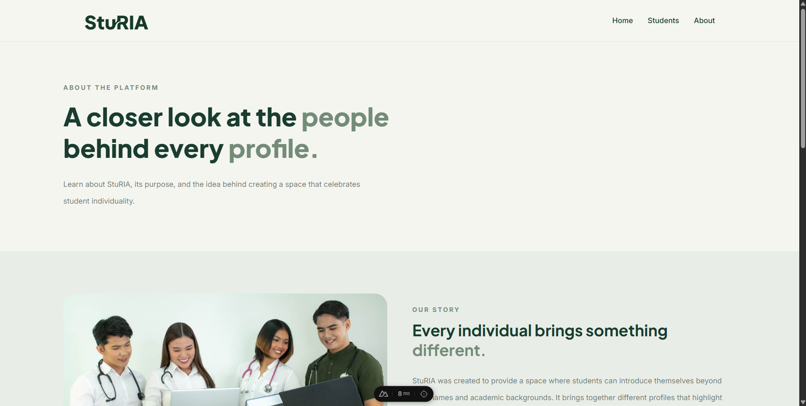

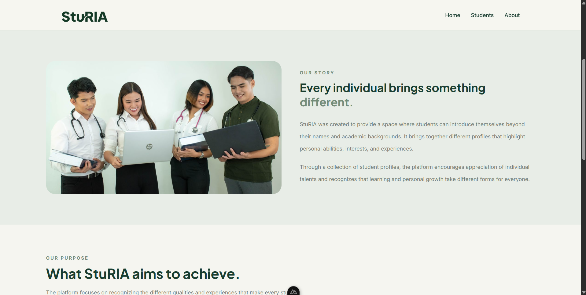

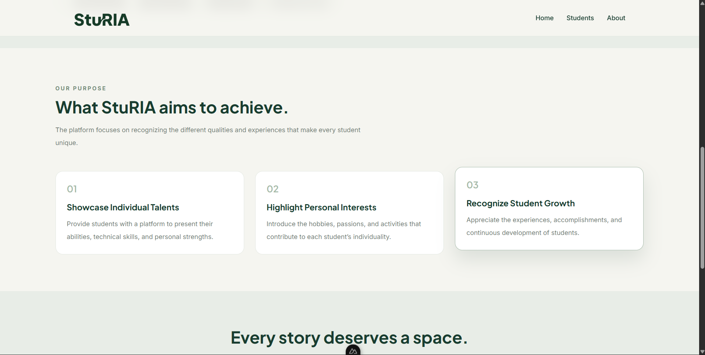

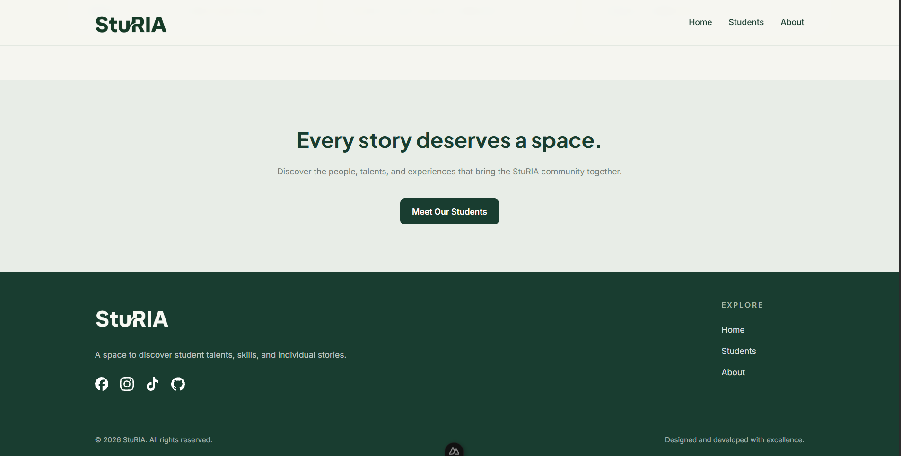

### 4. Website Footer

The reusable footer appears across the website pages and contains the STURIA branding, navigation links, and social media icons.

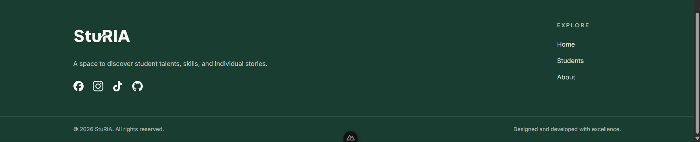

## Reusable Components

The project includes five reusable Vue components located inside `app/components/`.

| Component | Description |
|---|---|
| `AppHeader.vue` | Displays the website navigation and logo. |
| `AppFooter.vue` | Displays the website footer and navigation links. |
| `StudentCard.vue` | Displays student information using props. |
| `InfoCard.vue` | Displays a title and description for informational sections. |
| `AppButton.vue` | Provides reusable buttons with customizable labels, colors, and navigation destinations. |

### Component Reusability and Props

STURIA demonstrates component-based development through the following implementations:

1. **StudentCard.vue** – Uses props to receive student information, including name, course, image, description, skills, and social media links.
2. **AppButton.vue** – Uses props such as `label`, `color`, and `to` to customize button appearance and behavior.
3. **AppHeader.vue and AppFooter.vue** – Shared through the default layout so they can be displayed across multiple pages.
4. **InfoCard.vue** – Reused to present different information and objectives without repeating the same component structure.

The homepage and student directory also demonstrate the use of multiple student cards with different data.

## Project Structure

The following screenshots show the organization of the project's application files, components, pages, public assets, and configuration files.

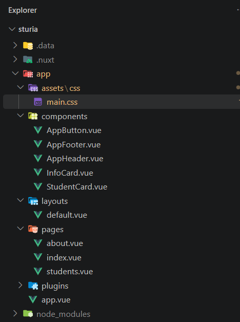

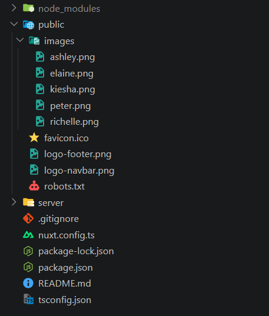

## Installation and Setup

Follow these steps to run the project locally.

### 1. Clone the Repository

```bash
git clone https://github.com/elainemaebalbada/StuRIA-act2.git
```

### 2. Navigate to the Project Directory

```bash
cd StuRIA-act2
```

### 3. Install Dependencies

```bash
npm install
```

### 4. Run the Development Server

```bash
npm run dev
```

Open the local development URL displayed in your terminal, usually:

```text
http://localhost:3000
```

## Learning Outcomes

Through this activity, the project demonstrates:

- Understanding component-based development using Vue.
- Creating reusable components inside the `app/components/` directory.
- Passing data between components using props.
- Reusing the same header and footer across multiple pages.
- Customizing reusable components through configurable properties.
- Organizing a Nuxt application using reusable components and a structured project directory.

## Repository

**GitHub:** [StuRIA – Student Portfolio and Skills Showcase](https://github.com/elainemaebalbada/StuRIA-act2)

---

**Developed by Elaine Mae M. Balbada**  
**ITE 18 – AIEM1**
